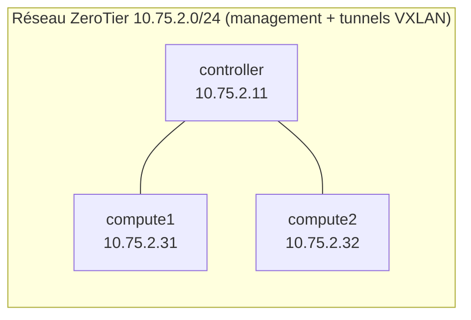

# Cloud privé OpenStack multi-nœuds (QEMU + ZeroTier)

Atelier 2 OpenStack - ENSAH, GL / ID3 - Université Abdelmalek Essaâdi - 2026/2027

Déploiement manuel d'un cloud privé IaaS **OpenStack 2024.1 (« Caracal »)** sur **Ubuntu Server 24.04 LTS**, selon l'Install Guide officiel : **1 nœud contrôleur + 2 nœuds compute**.

## Architecture

| Élément | Choix |
|---|---|
| Système des 3 nœuds | Ubuntu Server 24.04 LTS (machines virtuelles VirtualBox) |
| Version d'OpenStack | 2024.1 (paquets Ubuntu) |
| Hyperviseur | **QEMU** (émulation, `virt_type = qemu`) : pas de KVM disponible |
| Réseau de management | ZeroTier (chiffré), plage 10.75.2.0/24 |
| Réseaux des VM | self-service **VXLAN** + routeur virtuel |
| Image de test | CirrOS 0.6.2 (x86_64) |
| Services installés | Keystone, Glance, Placement, Nova, Neutron, Horizon |
| Services de support | MariaDB, RabbitMQ, Memcached, Chrony |

## Avancement

| Séance | Contenu | État |
|---|---|---|
| Jour 1 | Étude, vérification matériel, ZeroTier, noms d'hôte, horloge | Terminé |
| Jour 2 | MariaDB, RabbitMQ, Memcached, Keystone, Glance, Placement | Terminé |
| Jour 3 | Nova (contrôleur + 2 compute, QEMU) | Terminé |
| Jour 4 | Neutron (VXLAN) + Horizon | Terminé |
| Jour 5 | Ressources Cloud, lancement des VM, tests et validation | À faire |

## Contenu du dépôt

| Dossier / fichier | Rôle |
|---|---|
| `docs/01-etude-prealable.md` | Partie 1 : OpenStack, composants, matériel, choix de méthode |
| `docs/02-installation.md` | Partie 2 : journal d'installation jour par jour |
| `docs/03-ressources-cloud.md` | Partie 3 : image, flavor, réseaux, routeur, clés, VM |
| `docs/04-tests-validation.md` | Partie 4 : tests et résultats |
| `docs/05-problemes-solutions.md` | Erreurs rencontrées, diagnostic et solutions |
| `docs/images/` | Captures d'écran de notre environnement |
| `configs/` | Fichiers de configuration **nettoyés** (sans mot de passe), par machine |
| `evidence/` | Sorties texte des commandes de vérification (avec date et nom d'hôte) |
| `scripts/` | Scripts de nettoyage des configs, de collecte et de contrôle des secrets |
| `rapport/` | Compte rendu final (PDF) |

## Sécurité

- Le mot de passe de laboratoire est remplacé par `<PASSWORD>` dans tous les fichiers publiés.
- Aucune clé privée, aucun jeton, aucun fichier `*-openrc` n'est versionné (voir `.gitignore`).
- Aucun service n'est exposé sur Internet : toutes les communications passent par le réseau ZeroTier privé.
- Avant chaque commit : `./scripts/check-secrets.sh`.

## Équipe

| Nom | Rôle principal |
|---|---|
| Prénom Nom 1 | Nœud contrôleur, dépôt GitHub |
| Prénom Nom 2 | Nœud compute1 |
| Prénom Nom 3 | Nœud compute2 |

Les trois membres ont participé à l'installation, aux tests et à la rédaction.

## Références

- Documentation officielle OpenStack : https://docs.openstack.org/
- Install Guide : https://docs.openstack.org/install-guide/
- CirrOS : https://github.com/cirros-dev/cirros
- ZeroTier : https://docs.zerotier.com/
