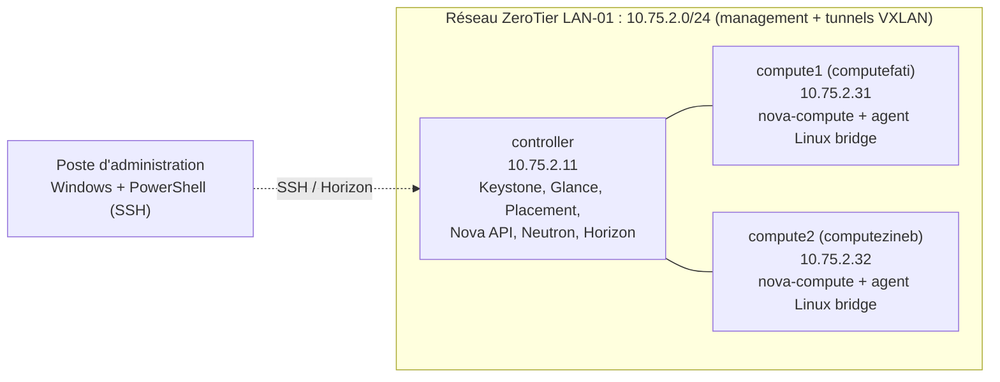
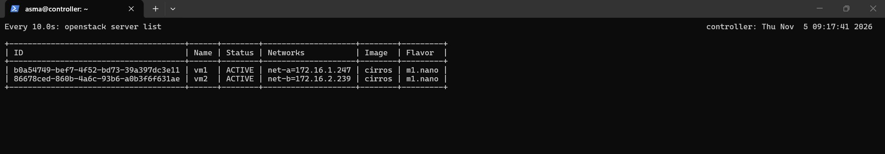
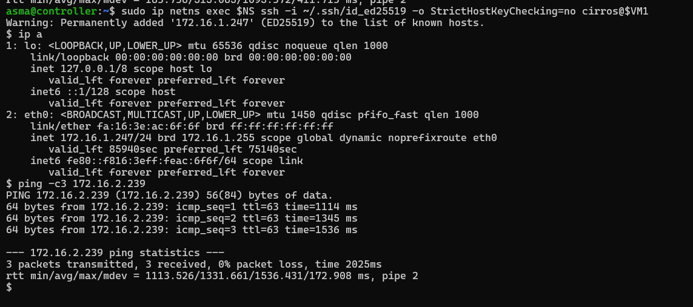
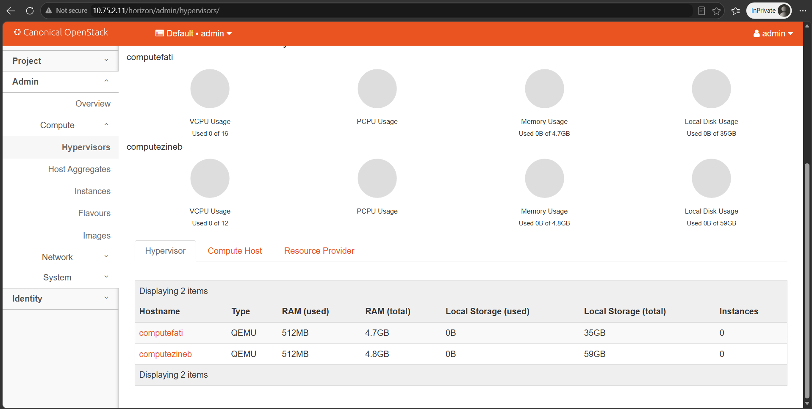

# Cloud privé OpenStack multi-nœuds : QEMU + ZeroTier

Ce projet met en œuvre un cloud privé IaaS **OpenStack 2024.1 (Caracal)** composé d'**un nœud contrôleur et de deux nœuds compute**, hébergés sur trois machines distinctes et reliés par un **VPN ZeroTier**. Le déploiement est entièrement **manuel**, service par service, conformément à l'Install Guide officiel : aucun outil d'installation automatique (DevStack, MicroStack, Kolla-Ansible) n'a été utilisé.

**Compétences illustrées** : administration Linux, réseau (VPN, VXLAN, ponts Linux, espaces de noms), architecture distribuée OpenStack.

## Choix d'architecture

| Choix | Justification |
|---|---|
| Installation manuelle plutôt que DevStack | DevStack est mono-nœud et masque la configuration. Le déploiement manuel donne la maîtrise de chaque fichier `.conf`, de chaque base de données et de chaque endpoint, et permet de diagnostiquer les pannes (voir les [8 incidents documentés](docs/05-problemes-solutions.md)). |
| ZeroTier plutôt qu'un réseau local commun | Les trois machines sont physiquement séparées. ZeroTier fournit des adresses fixes, un trafic chiffré et aucune exposition sur Internet. |
| QEMU plutôt que KVM | Les machines virtuelles n'exposent pas `vmx`/`svm` (`egrep -c` renvoie 0). `virt_type = qemu` évite un échec silencieux de KVM. |
| VXLAN pour les réseaux des instances | Pas de seconde carte réseau « provider » : le trafic des instances est encapsulé dans le tunnel ZeroTier. |

Détail complet : [docs/06-choix-techniques.md](docs/06-choix-techniques.md).

## Architecture

| Élément | Choix |
|---|---|
| Système des 3 nœuds | Ubuntu Server 24.04 LTS (VirtualBox) |
| Version d'OpenStack | 2024.1 « Caracal » (paquets Ubuntu, Neutron 24.2.2) |
| Hyperviseur | QEMU (`virt_type = qemu`) |
| Réseau de management | ZeroTier, plage 10.75.2.0/24 |
| Réseaux des instances | Self-service VXLAN + routeur virtuel |
| Image de test | CirrOS 0.6.2 x86_64 |
| Services OpenStack | Keystone, Glance, Placement, Nova, Neutron, Horizon |
| Services de support | MariaDB 10.11, RabbitMQ, Memcached, Chrony |

## Résultats

Le cloud est opérationnel de bout en bout : deux réseaux privés reliés par un routeur virtuel, deux instances en `ACTIVE` sur des réseaux distincts, connectivité entre elles à travers le routeur, accès SSH par clé, et administration via Horizon à travers le VPN.

## Documentation

| Document | Contenu |
|---|---|
| [01 - Étude préalable](docs/01-etude-prealable.md) | OpenStack, composants, matériel, vérification de la virtualisation |
| [02 - Installation](docs/02-installation.md) | Journal d'installation jour par jour, avec captures |
| [03 - Ressources cloud](docs/03-ressources-cloud.md) | Flavor, réseaux, routeur, clé SSH, groupe de sécurité, instances |
| [04 - Tests et validation](docs/04-tests-validation.md) | Plan de tests, résultats et limites constatées |
| [05 - Problèmes et solutions](docs/05-problemes-solutions.md) | 8 incidents : symptôme, diagnostic, cause, correctif |
| [06 - Choix techniques](docs/06-choix-techniques.md) | Justification de la méthode, du VPN, de QEMU, de VXLAN |

## Structure du dépôt

| Dossier | Rôle |
|---|---|
| `docs/` | Documentation et captures (`docs/images/`) |
| `configs/` | Fichiers de configuration réels **nettoyés** (sans commentaires, sans mot de passe), par machine |
| `evidence/` | Sorties brutes des commandes de vérification, avec nom d'hôte et date |
| `scripts/` | Nettoyage des configurations, collecte des preuves, contrôle des secrets |
| `rapport/` | Compte rendu final (PDF) |

## Sécurité

- Le mot de passe de laboratoire est remplacé par `<PASSWORD>` dans tous les fichiers publiés (`scripts/sanitize-configs.sh`).
- Aucune clé, aucun jeton, aucun fichier `*-openrc` n'est versionné (voir `.gitignore`).
- Les captures publiées sont contrôlées : identifiant du réseau ZeroTier, adresses IP publiques et mots de passe d'instances masqués.
- Aucun service n'est exposé sur Internet : tous les échanges transitent par le réseau privé ZeroTier.

## Équipe

Projet réalisé en trinôme.

| Membre | Responsabilité |
|---|---|
| Asmae Abakouy | Nœud contrôleur (ensemble des services de contrôle), architecture réseau ZeroTier |
| Fati | Nœud compute1 (`computefati`, 10.75.2.31) |
| Zineb | Nœud compute2 (`computezineb`, 10.75.2.32) |

## Références

- Documentation OpenStack : https://docs.openstack.org/
- Install Guide : https://docs.openstack.org/install-guide/
- CirrOS : https://github.com/cirros-dev/cirros
- ZeroTier : https://docs.zerotier.com/
