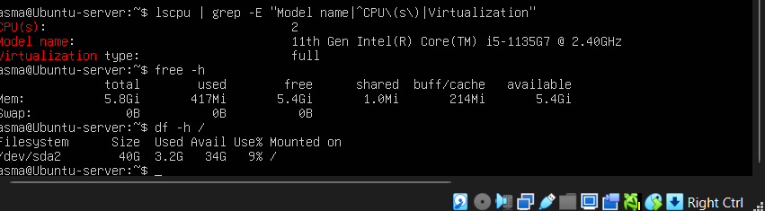
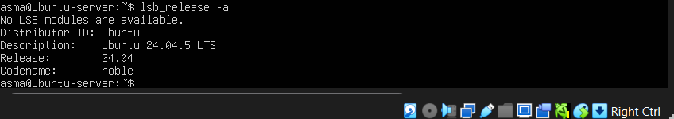
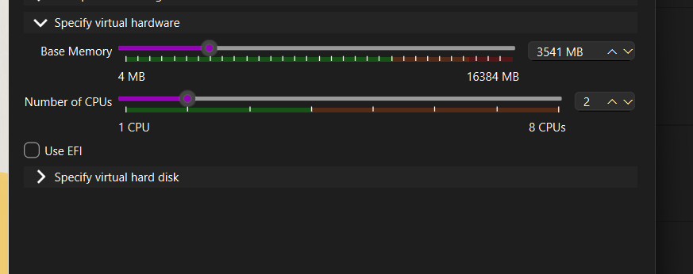
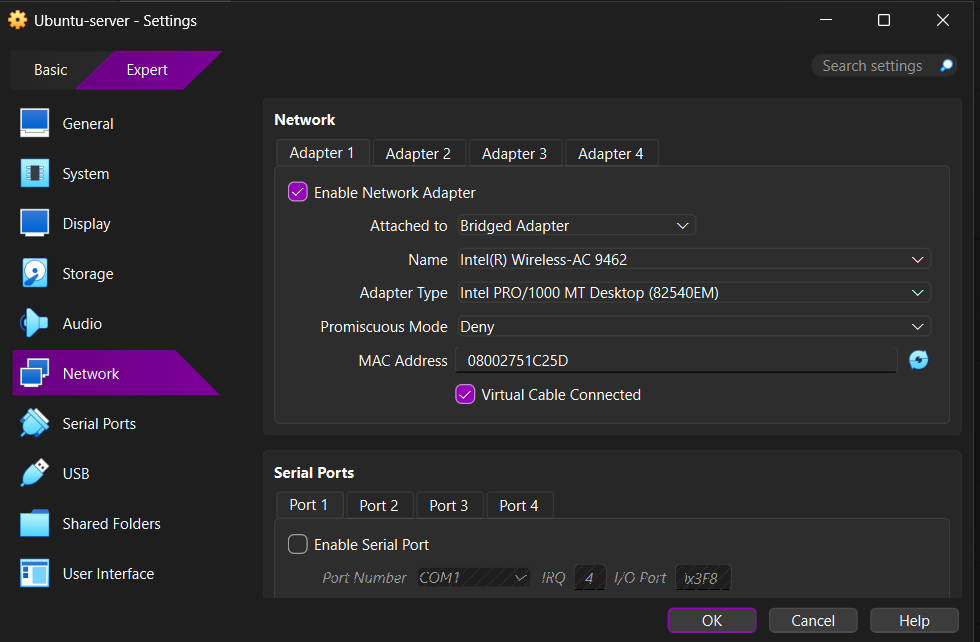

# Partie 1 : Étude préalable et préparation

## 1. OpenStack et son intérêt pour un cloud privé

OpenStack est une plateforme open source qui transforme un ensemble de serveurs en cloud privé de type IaaS : machines virtuelles, réseaux virtuels et stockage à la demande, pilotés par une interface web (Horizon), une API REST ou la ligne de commande.

Intérêts : les données restent dans notre infrastructure, pas de licence ni de dépendance à un fournisseur, libre-service avec quotas et multi-projets, et extension de la capacité par simple ajout de nœuds compute.

## 2. Composants et rôles

| Service | Rôle | Déployé |
|---|---|---|
| Keystone | Authentification, autorisation, catalogue des services | Oui |
| Nova | Cycle de vie des VM (`nova-api`, scheduler, conductor sur le contrôleur ; `nova-compute` sur chaque compute, via libvirt/QEMU) | Oui |
| Neutron | Réseaux virtuels, sous-réseaux, routeurs, groupes de sécurité, DHCP | Oui |
| Glance | Catalogue des images disque | Oui |
| Placement | Inventaire des ressources (CPU, RAM, disque) et allocations ; aide le scheduler de Nova à choisir un hôte | Oui |
| Horizon | Interface web d'administration | Oui |
| Cinder | Volumes de stockage en mode bloc | Non (hors périmètre) |

Services de support : MariaDB (bases de données), RabbitMQ (messages entre services), Memcached (cache de jetons), Chrony (synchronisation d'horloge).

**Flux de lancement d'une VM** : le client obtient un jeton auprès de Keystone, appelle Nova API, le scheduler interroge Placement pour choisir un hôte, `nova-compute` de l'hôte récupère l'image chez Glance, demande un port à Neutron, puis libvirt/QEMU démarre l'instance.

## 3. Machines utilisées

Trois machines virtuelles VirtualBox sous Ubuntu Server 24.04 LTS, une par membre de l'équipe, reliées par ZeroTier.

**Contrôleur** (mesures relevées sur la machine du contrôleur) :

| Élément | Valeur | Preuve |
|---|---|---|
| Processeur hôte | Intel Core i5-1135G7 @ 2,40 GHz, 2 vCPU alloués |  |
| Mémoire | 5,8 GiB | idem |
| Disque | 40 Go (3,2 Go utilisés après installation) | idem |
| Système | Ubuntu 24.04.5 LTS (noble) |  |
| Virtualisation matérielle | **Absente** : `egrep -c '(vmx\|svm)' /proc/cpuinfo` renvoie `0` |  |

**Nœuds compute** (capacités vues par OpenStack, Horizon, Admin > Hyperviseurs) :

| Nœud | Hostname | IP ZeroTier | RAM | Disque local | Type |
|---|---|---|---|---|---|
| compute1 | computefati | 10.75.2.31 | 4,7 Go | 35 Go | QEMU |
| compute2 | computezineb | 10.75.2.32 | 4,8 Go | 59 Go | QEMU |

Configuration VirtualBox du contrôleur :

## 4. Conséquence du matériel : QEMU et non KVM

Sans `vmx`/`svm`, KVM n'est pas utilisable. Les nœuds compute utilisent donc **QEMU en émulation pure** (`virt_type = qemu`). C'est plus lent mais fonctionnel, et c'est suffisant avec une image légère (CirrOS). Le choix est vérifié plus tard par `openstack hypervisor list` (type `QEMU`).

## 5. Choix de la méthode de déploiement

Installation manuelle selon l'Install Guide officiel. Justification détaillée dans [06-choix-techniques.md](06-choix-techniques.md).
