# Partie 2 : Journal d'installation (Jours 1 à 4)

Conventions : `<PASSWORD>` désigne le mot de passe de laboratoire (non publié). Les fichiers de configuration complets et nettoyés sont dans [`../configs/`](../configs/). Réseau ZeroTier : controller 10.75.2.11, compute1 (`computefati`) 10.75.2.31, compute2 (`computezineb`) 10.75.2.32.

Ce document décrit l'installation du **nœud contrôleur**. Les nœuds compute1 et compute2 (`nova-compute` et agent Neutron) ont été installés par leurs responsables respectifs à partir des mêmes fichiers de référence, puis validés depuis le contrôleur (enregistrement des hôtes, agents `UP`).

## Jour 1 : Préparation

**Nom d'hôte** :
```bash
sudo hostnamectl set-hostname controller
```
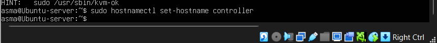

**ZeroTier** (réseau privé chiffré) : création du réseau sur my.zerotier.com, puis sur chaque machine :
```bash
curl -s https://install.zerotier.com | sudo bash
sudo zerotier-cli join <NETWORK_ID>
```
Chaque membre est autorisé depuis la console ZeroTier et reçoit une IP fixe.

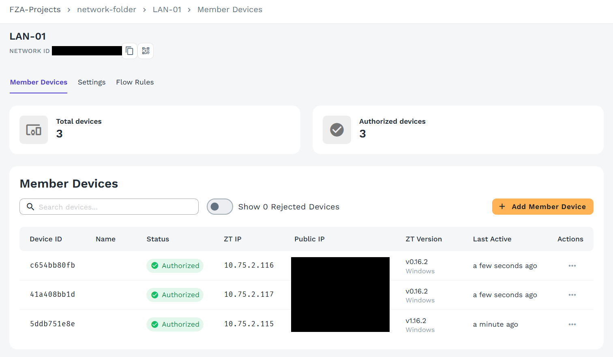
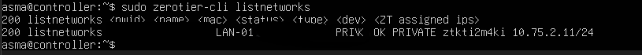

Vérification : l'interface ZeroTier porte bien 10.75.2.11 et les nœuds se répondent.

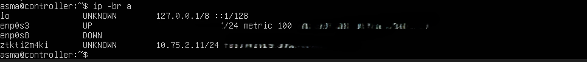
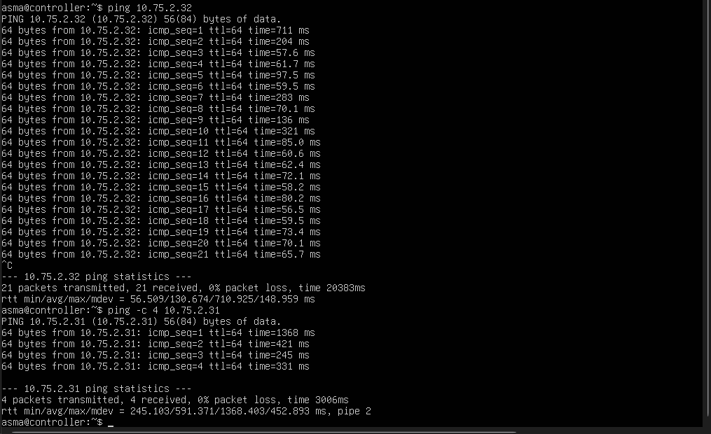

**Résolution de noms** (`/etc/hosts`) : controller, computefati et computezineb pointent vers leurs IP ZeroTier ; la ligne `127.0.1.1` est supprimée pour que `controller` ne se résolve jamais en boucle locale.

**Horloge** (Chrony) : le contrôleur sert l'heure au réseau ZeroTier, les compute le prennent pour source (`server controller iburst`). Une dérive d'horloge casse les jetons Keystone.
```bash
sudo apt install -y chrony
echo "allow 10.75.2.0/24" | sudo tee -a /etc/chrony/chrony.conf
sudo systemctl restart chrony
```
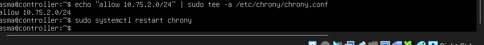

**Module `br_netfilter`** : nécessaire pour que les groupes de sécurité s'appliquent aux ponts réseau.
```bash
sudo modprobe br_netfilter
echo br_netfilter | sudo tee /etc/modules-load.d/br_netfilter.conf
printf "net.bridge.bridge-nf-call-iptables=1\nnet.bridge.bridge-nf-call-ip6tables=1\n" | sudo tee /etc/sysctl.d/99-openstack.conf
sudo sysctl --system
```
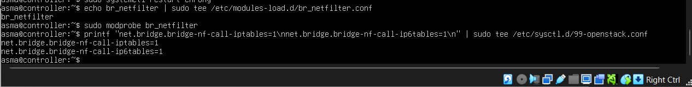

## Jour 2 : Services de base, Keystone, Glance, Placement

**Services de base** :
```bash
sudo apt install -y mariadb-server python3-pymysql rabbitmq-server memcached \
  python3-memcache python3-openstackclient
```
- **MariaDB** : `bind-address = 10.75.2.11` (écoute uniquement sur ZeroTier), `mysql_secure_installation`, une base et un utilisateur par service.
- **RabbitMQ** : utilisateur `openstack` avec droits de configuration, écriture et lecture.
- **Memcached** : écoute sur `10.75.2.11`. Un fichier systemd attend l'IP ZeroTier avant le démarrage (incident n°2).

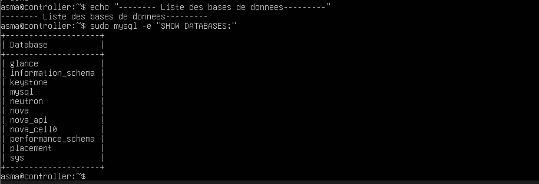
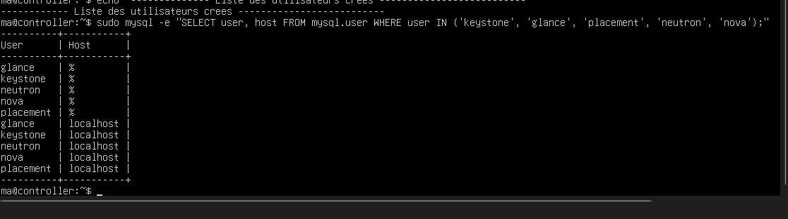
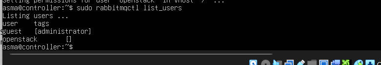

**Keystone** : `keystone-manage db_sync`, `fernet_setup`, `credential_setup`, `bootstrap` ; création du projet `service` ; fichier `admin-openrc` (non publié).

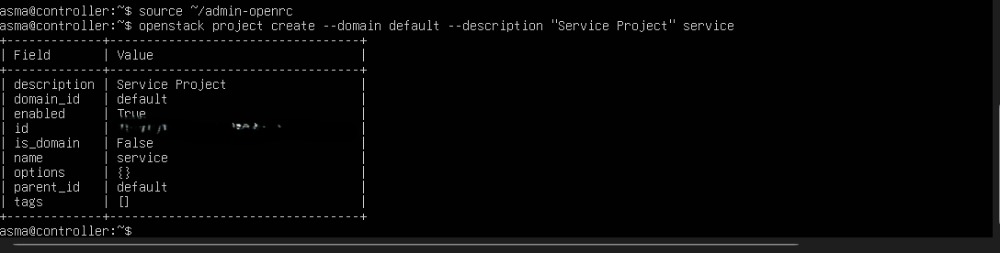

**Glance** : utilisateur, rôle `admin`, service `image`, 3 endpoints, `glance-manage db_sync`, puis import de CirrOS 0.6.2 :
```bash
openstack image create "cirros" --file cirros-0.6.2-x86_64-disk.img \
  --disk-format qcow2 --container-format bare --public
```
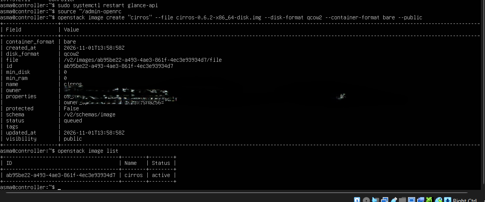

**Placement** : même schéma ; `placement-manage db sync` ; contrôle avec `sudo placement-status upgrade check`.

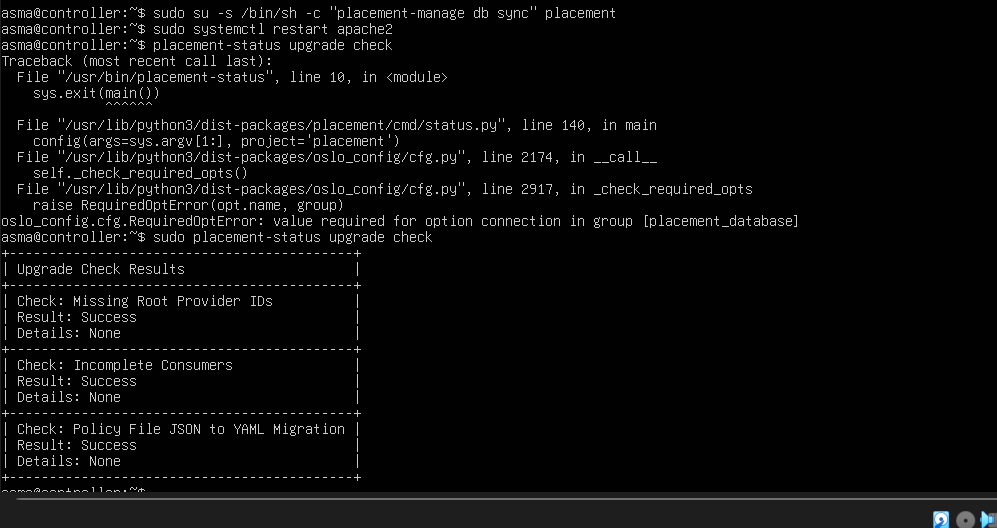

Catalogue final des services et endpoints (après correction de l'incident n°1) :

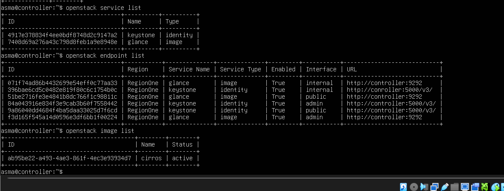

## Jour 3 : Nova avec QEMU

**Contrôleur** : utilisateur, service `compute` et endpoints ; paquets `nova-api nova-conductor nova-novncproxy nova-scheduler` ; configuration de `nova.conf` (bases, RabbitMQ, Keystone, VNC, Glance, Placement) ; puis :
```bash
sudo su -s /bin/sh -c "nova-manage api_db sync" nova
sudo su -s /bin/sh -c "nova-manage cell_v2 map_cell0" nova
sudo su -s /bin/sh -c "nova-manage cell_v2 create_cell --name=cell1 --verbose" nova
sudo su -s /bin/sh -c "nova-manage db sync" nova
sudo su -s /bin/sh -c "nova-manage cell_v2 list_cells" nova
```
L'avertissement « RLock(s) were not greened » est sans conséquence (incident n°7).

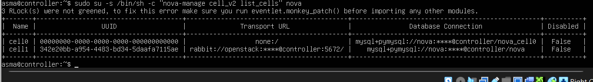

**Nœuds compute** : paquet `nova-compute`, `nova.conf` avec `my_ip` propre à chaque machine et, dans `/etc/nova/nova-compute.conf` :
```ini
[libvirt]
virt_type = qemu
```
**Contrôleur** : découverte des hôtes puis contrôle.
```bash
sudo su -s /bin/sh -c "nova-manage cell_v2 discover_hosts --verbose" nova
openstack compute service list --service nova-compute
openstack hypervisor list
```
Les deux `nova-compute` sont `up`, et le type d'hyperviseur est bien `QEMU` :

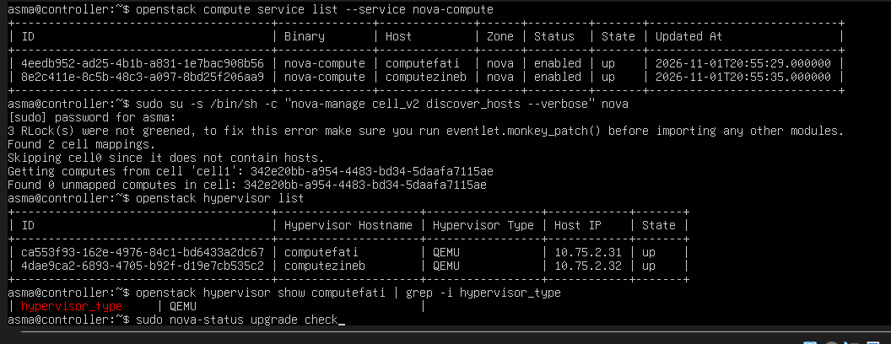
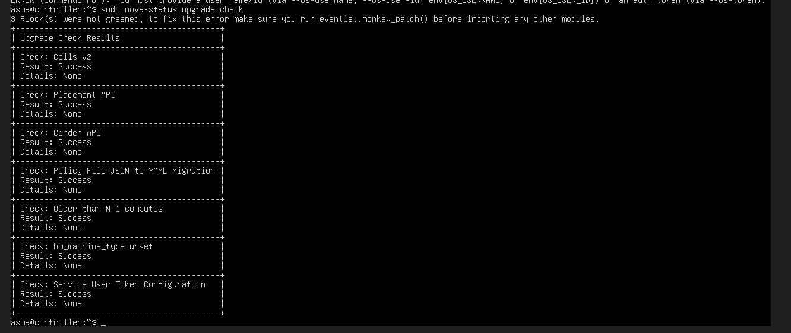

## Jour 4 : Neutron et Horizon

**Contrôleur** : utilisateur, service `network` et endpoints ; paquets `neutron-server neutron-plugin-ml2 neutron-linuxbridge-agent neutron-l3-agent neutron-dhcp-agent neutron-metadata-agent` ; fichiers `neutron.conf`, `ml2_conf.ini`, `linuxbridge_agent.ini`, `l3_agent.ini`, `dhcp_agent.ini`, `metadata_agent.ini` ; section `[neutron]` dans `nova.conf` ; puis :
```bash
sudo su -s /bin/sh -c "neutron-db-manage --config-file /etc/neutron/neutron.conf \
  --config-file /etc/neutron/plugins/ml2/ml2_conf.ini upgrade head" neutron
```
Choix techniques : réseaux de projet en **VXLAN** (VNI 1:1000, `l2_population`), `local_ip` = IP ZeroTier de chaque machine, pas de réseau « provider ». Voir [06-choix-techniques.md](06-choix-techniques.md).

**Nœuds compute** : `neutron-linuxbridge-agent`, `neutron.conf` minimal (RabbitMQ et Keystone, sans base de données), `linuxbridge_agent.ini` avec leur propre `local_ip`.

Vérification des agents :

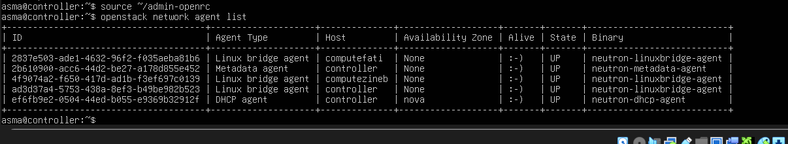

Vue d'ensemble (services, calcul, agents, hyperviseurs) :

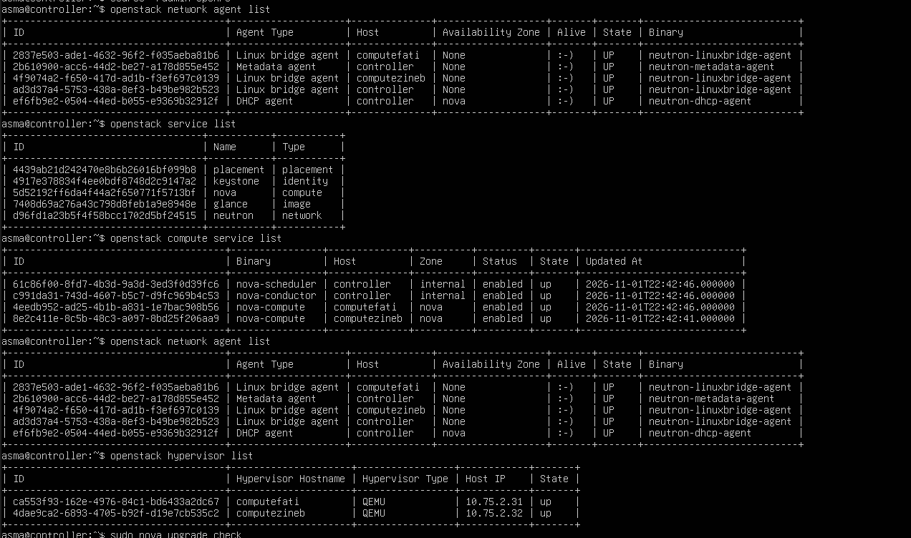

**Horizon** : paquet `openstack-dashboard`, puis dans `/etc/openstack-dashboard/local_settings.py` : `OPENSTACK_HOST`, `ALLOWED_HOSTS`, `SESSION_ENGINE`, `CACHES` (Memcached), `OPENSTACK_KEYSTONE_URL`, `OPENSTACK_API_VERSIONS`, `TIME_ZONE = "Africa/Casablanca"`.

Accès depuis un poste Windows membre du réseau ZeroTier : `http://10.75.2.11/horizon` (domaine `Default`, utilisateur `admin`).

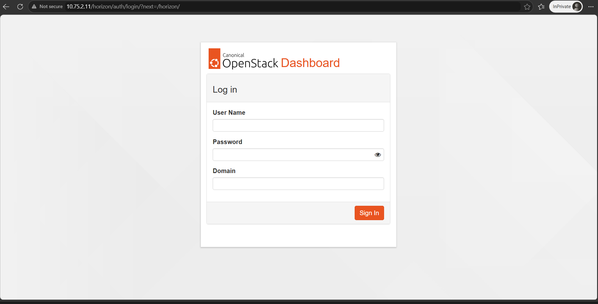
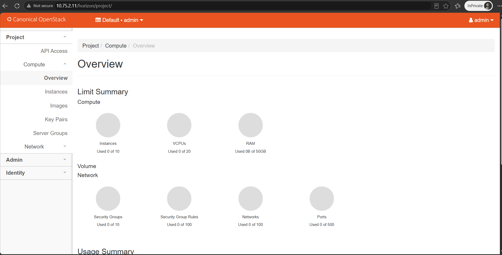
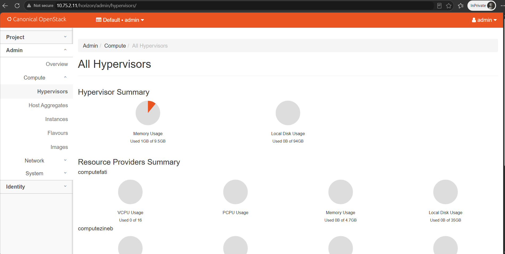
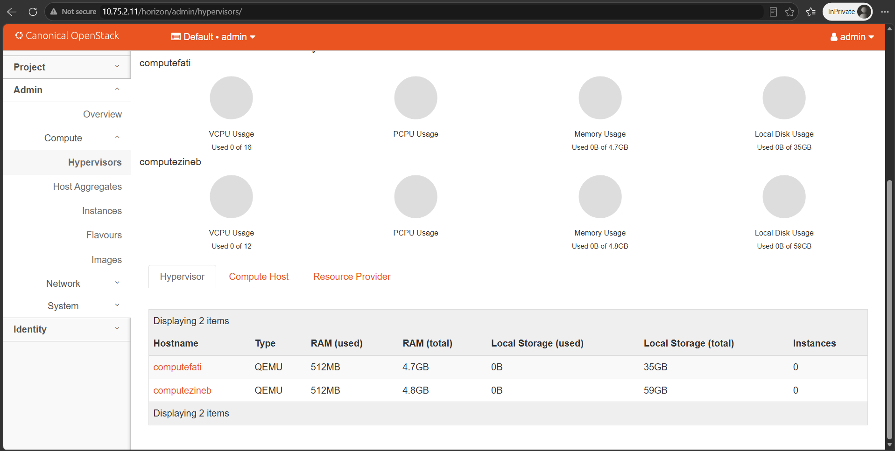

## Administration à distance

Le contrôleur est administré en SSH depuis PowerShell (Windows), à travers le réseau ZeroTier, sans aucun port ouvert vers Internet. Le service SSH est activé au démarrage, puis la connexion s'établit sur l'IP ZeroTier du contrôleur :
```bash
sudo systemctl enable --now ssh
```
```powershell
ssh asma@10.75.2.11
```
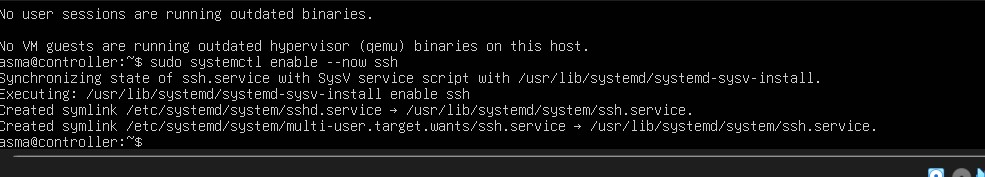
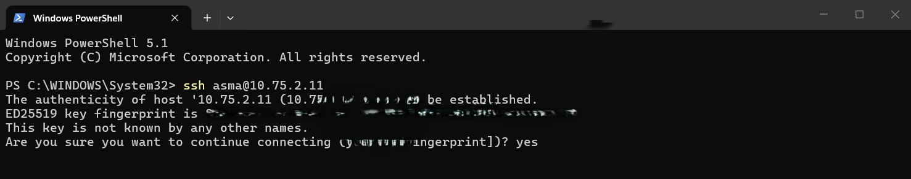

## Jour 5

Ressources cloud et tests : voir [03-ressources-cloud.md](03-ressources-cloud.md) et [04-tests-validation.md](04-tests-validation.md).
