# Partie 3 : Création et administration des ressources cloud

Toutes les commandes sont exécutées sur le contrôleur après `source ~/admin-openrc`. Les sorties brutes de vérification sont enregistrées dans [`../evidence/`](../evidence/) par `scripts/collect-evidence.sh`.

## 1. Flavor

Flavor `m1.nano` : 1 vCPU, 256 Mo de RAM, 1 Go de disque, adapté à CirrOS.
```bash
openstack flavor create --id auto --vcpus 1 --ram 256 --disk 1 m1.nano
```
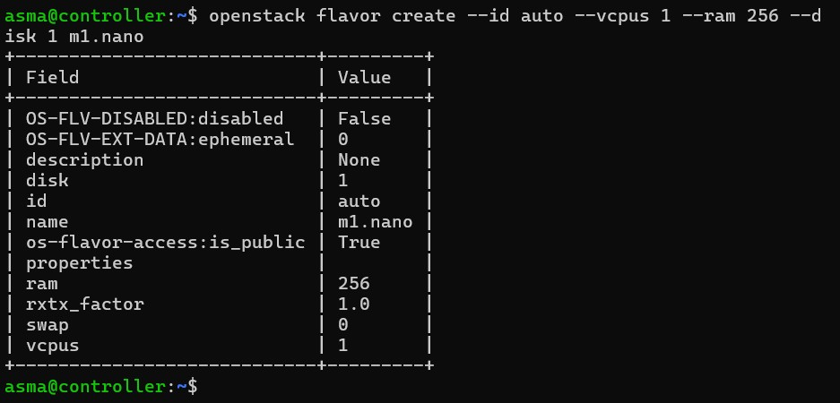

## 2. Réseaux et sous-réseaux privés

| Réseau | Sous-réseau | Plage | Passerelle | Type | Segment VXLAN |
|---|---|---|---|---|---|
| `net-a` | `subnet-a` | 172.16.1.0/24 | 172.16.1.1 | vxlan | 557 |
| `net-b` | `subnet-b` | 172.16.2.0/24 | 172.16.2.1 | vxlan | 291 |

```bash
openstack network create net-a
openstack subnet create --network net-a --subnet-range 172.16.1.0/24 --gateway 172.16.1.1 subnet-a
openstack network create net-b
openstack subnet create --network net-b --subnet-range 172.16.2.0/24 --gateway 172.16.2.1 subnet-b
```
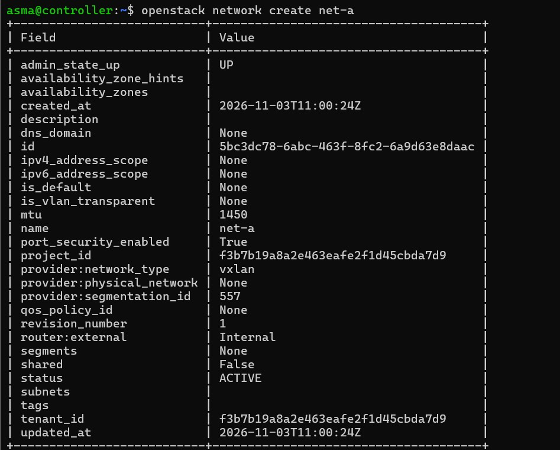
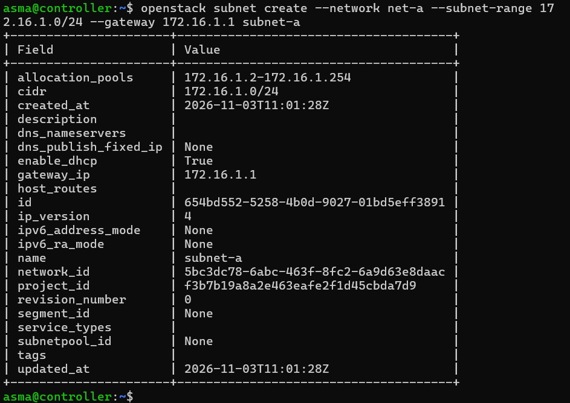
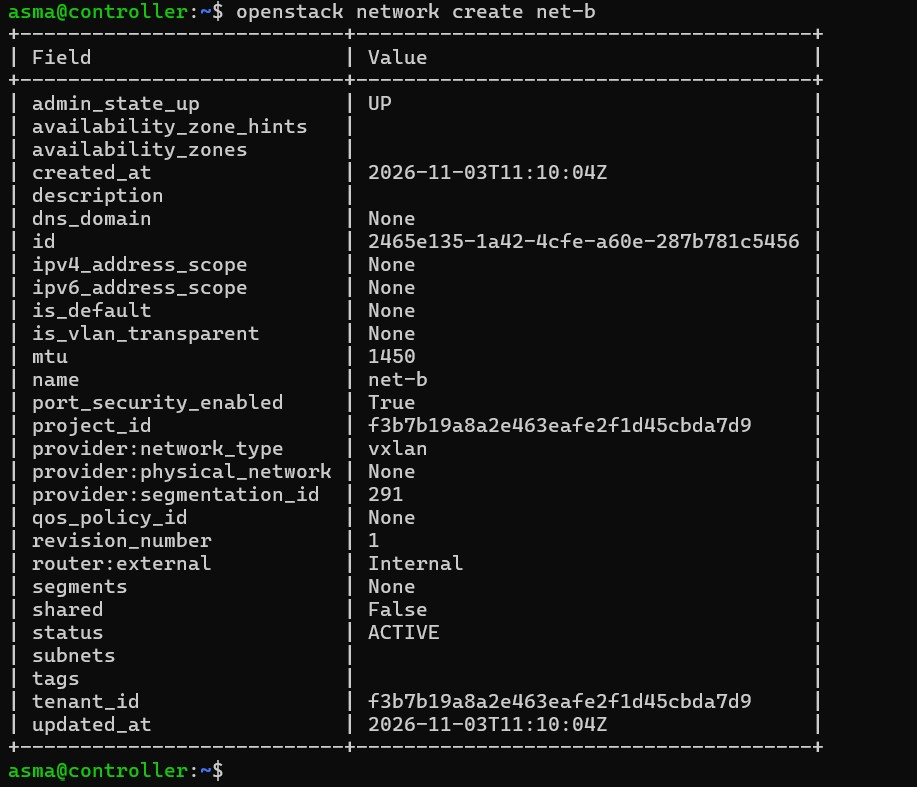
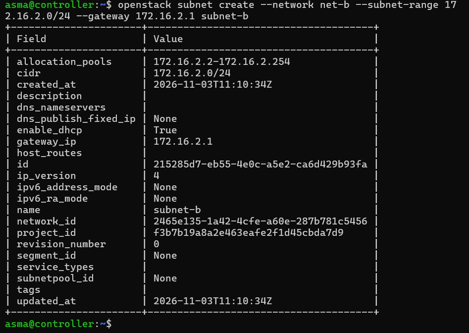

Le MTU de 1450 octets est celui d'un réseau VXLAN (50 octets d'encapsulation).

## 3. Routeur virtuel

Prérequis : le plugin de service `router` doit être activé dans `/etc/neutron/neutron.conf` (`service_plugins = router`), avec l'agent L3 en fonctionnement. Le routeur relie ensuite les deux sous-réseaux :
```bash
openstack router create router1
openstack router add subnet router1 subnet-a
openstack router add subnet router1 subnet-b
```
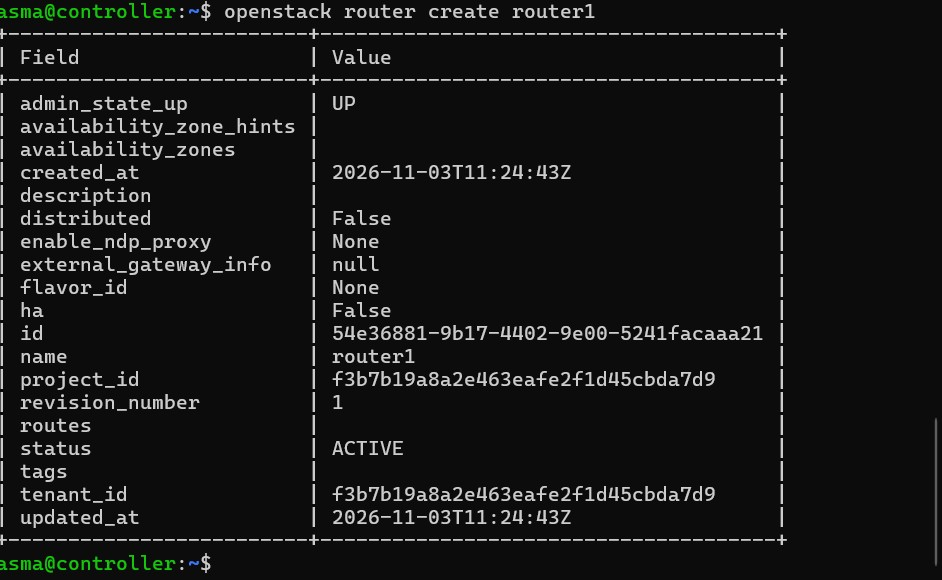
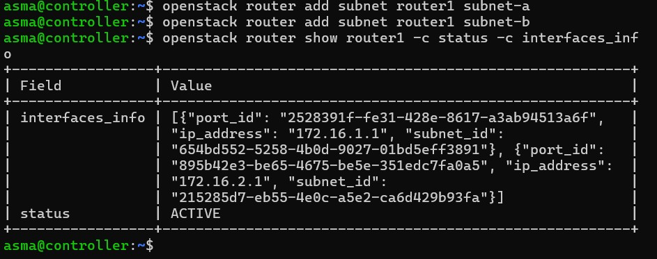

## 4. Clé SSH

Une paire de clés ed25519 est générée sur le contrôleur, puis sa partie publique est enregistrée dans OpenStack :
```bash
ssh-keygen -t ed25519 -N "" -f ~/.ssh/id_ed25519
openstack keypair create --public-key ~/.ssh/id_ed25519.pub mykey
```
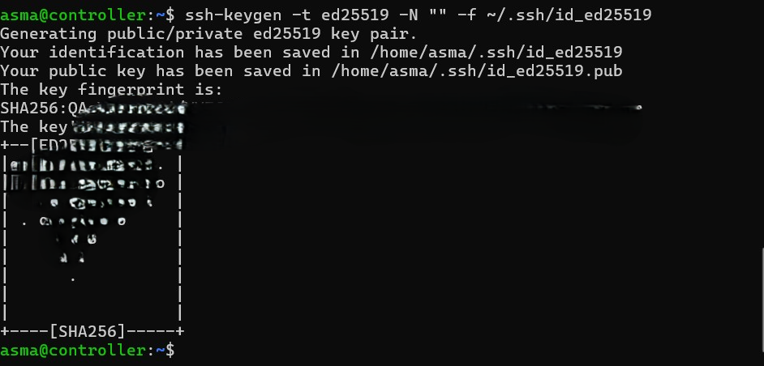
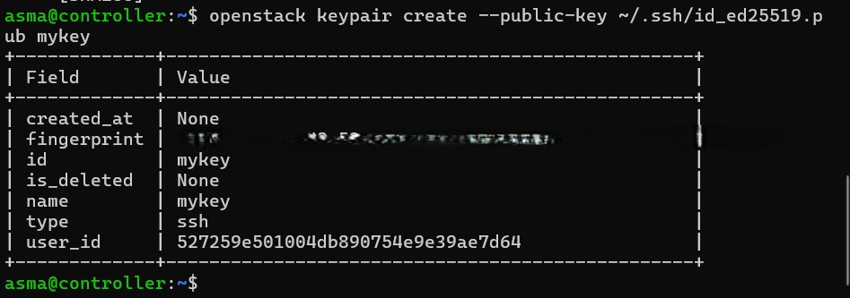

La clé privée reste sur le contrôleur et n'est jamais versionnée.

## 5. Groupe de sécurité `lab-sg`

Politique : ICMP et SSH (TCP 22) autorisés en entrée ; tout le reste refusé par défaut.
```bash
openstack security group create lab-sg --description "ICMP et SSH"
openstack security group rule create --proto icmp lab-sg
openstack security group rule create --proto tcp --dst-port 22 lab-sg
```
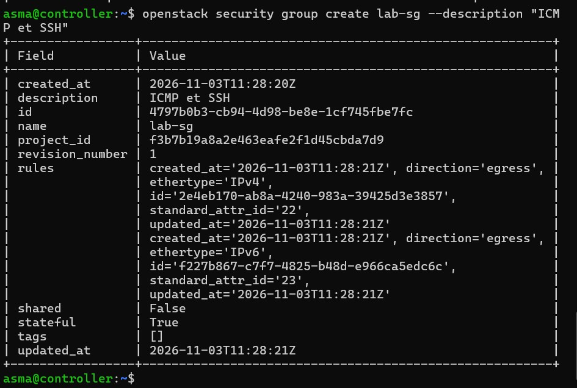
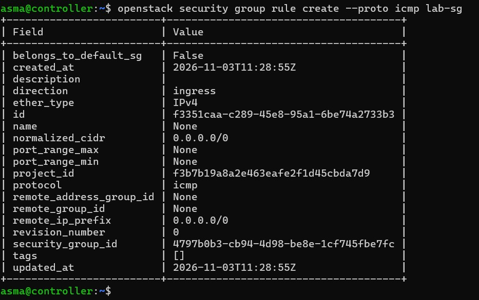
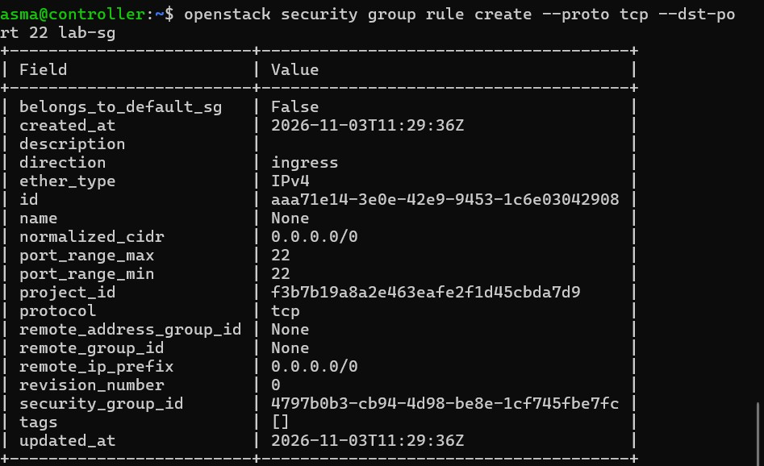
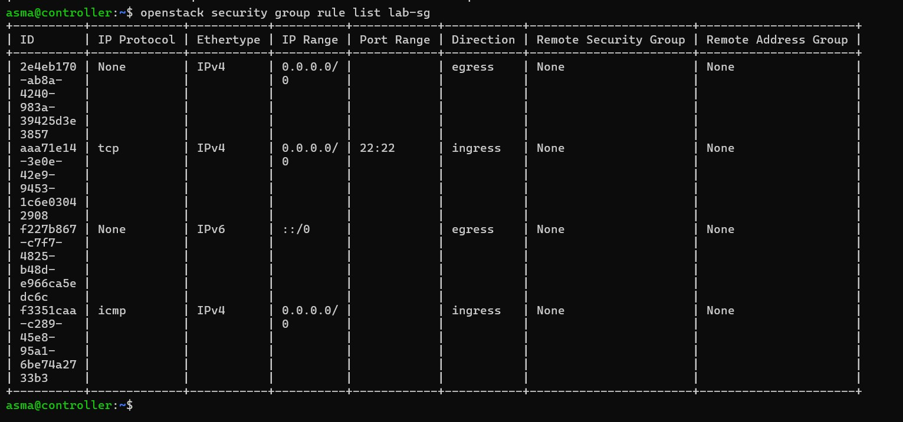

## 6. Instances

`vm1` est placée sur `net-a` et `vm2` sur `net-b`. Le placement sur un hôte précis est forcé avec `--availability-zone nova:<hôte>` :
```bash
openstack server create --flavor m1.nano --image cirros --network net-a \
  --security-group lab-sg --key-name mykey --availability-zone nova:computefati vm1
```
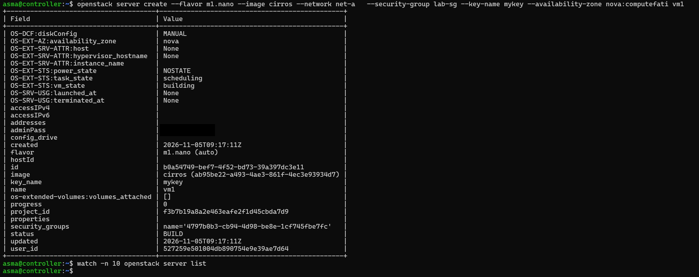
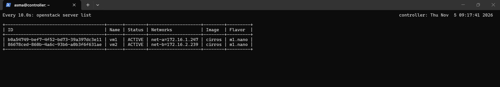

L'hôte de chaque instance est enregistré dans `evidence/16-servers.txt` (`openstack server list --long`).

## 7. Accès aux instances

Aucun réseau « provider » n'est disponible (voir [06-choix-techniques.md](06-choix-techniques.md)) : les instances ne portent pas d'IP flottante. L'accès se fait depuis l'espace de noms réseau du routeur, qui est directement connecté aux deux sous-réseaux :
```bash
NS=qrouter-<id du routeur>
sudo ip netns exec $NS ping -c3 172.16.1.247
```
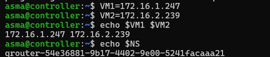
