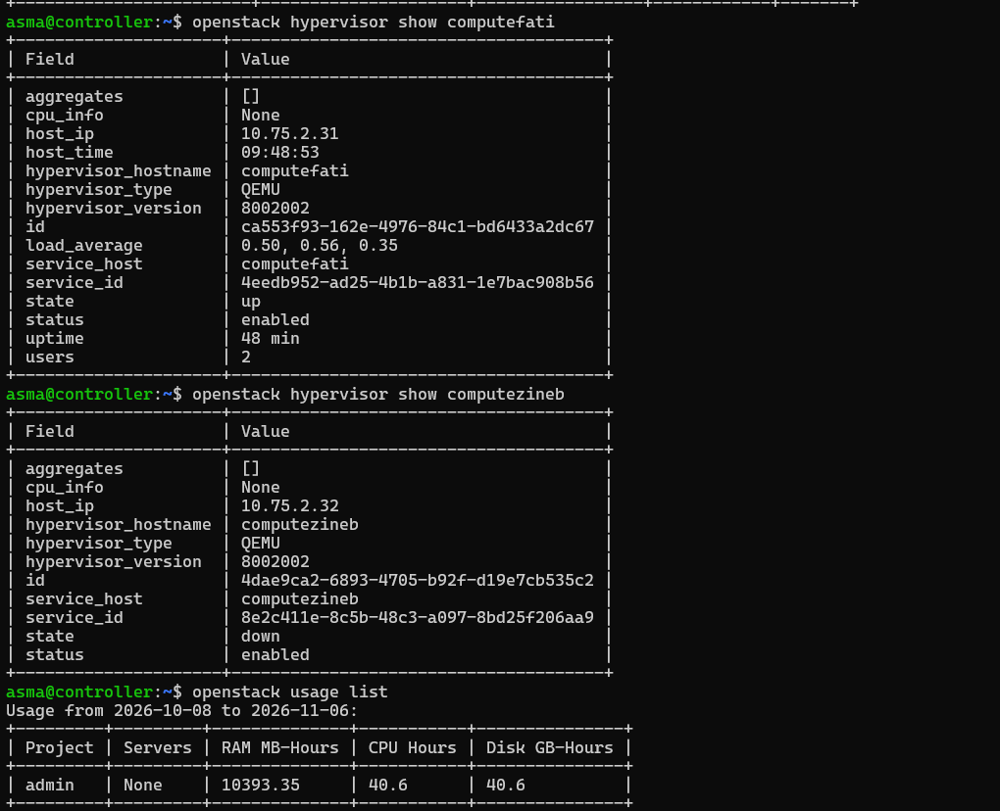
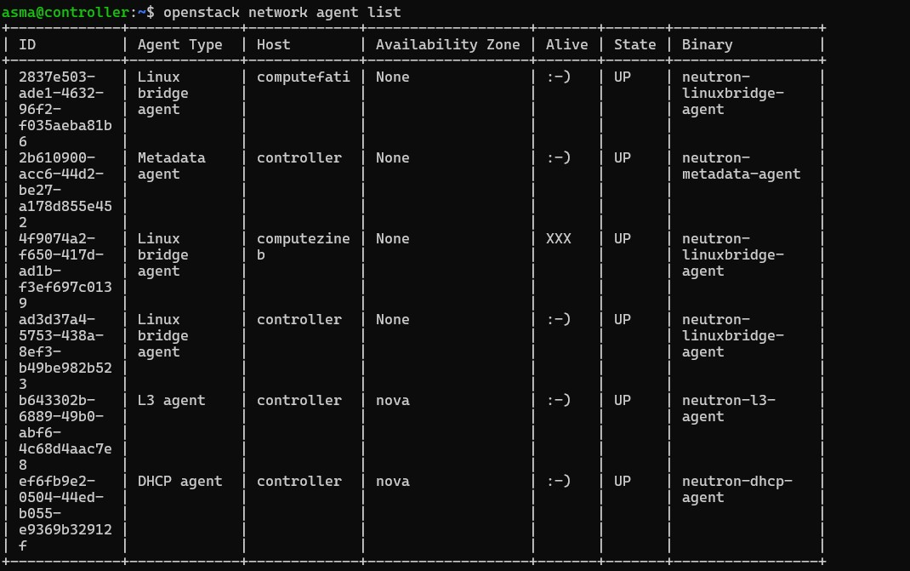

# Partie 4 : Tests et validation

## 1. Plan de tests et résultats

| # | Test | Résultat observé | Preuve |
|---|---|---|---|
| 1 | Démarrage des instances | `vm1` (net-a, 172.16.1.247) et `vm2` (net-b, 172.16.2.239) en `ACTIVE`, image `cirros`, flavor `m1.nano` | [capture](images/jour5-15-instances-actives.png), `evidence/16-servers.txt` |
| 2 | Ping de `vm1` et `vm2` depuis l'espace de noms du routeur | Réponses ICMP des deux instances (voir les remarques ci-dessous) | [vm1](images/jour5-17-ping-vm1.png), [vm2](images/jour5-18-ping-vm2.png) |
| 3 | SSH par clé vers `vm1`, puis ping de `vm1` vers `vm2` | Connexion sans mot de passe ; `ping 172.16.2.239` répond avec `ttl=63`, preuve d'un saut par le routeur | [capture](images/jour5-19-ssh-vm1-ping-vm2.png) |
| 4 | Filtrage du groupe de sécurité | Règles `lab-sg` : ICMP et TCP/22 en entrée, sortie libre ; ping et SSH aboutissent | [règles](images/jour5-13-regles-lab-sg.png) |
| 5 | Placement forcé et cycle de vie d'une instance de test | `vm-test` créée sur `computefati`, puis `stop`, `start`, `reboot`, `delete` exécutés avec succès | [création](images/jour5-22-creation-vm-test.png), [cycle de vie](images/jour5-23-cycle-de-vie.png) |
| 6 | Supervision : consommation et ressources | Usage CPU/RAM visible dans Horizon ; `openstack usage list` ; fournisseurs de ressources Placement | [Horizon](images/jour5-21-horizon-usage.png), [Placement](images/jour5-26-placement-resource-providers.png) |

## 2. Remarques sur les mesures

- **Latence élevée (184 ms à 1,3 s)** : elle cumule le tunnel ZeroTier (chemin relayé, voir [06](06-choix-techniques.md)), l'encapsulation VXLAN et l'émulation QEMU sans accélération matérielle. Le comportement est normal pour un laboratoire de ce type.
- **Première série de pings vers `vm1` : 33 % de pertes**, puis 0 % à la série suivante. Elle est probablement liée à la fin du démarrage de l'instance et à l'établissement du chemin réseau dans le tunnel.
- **Connectivité inter-réseaux** : le test 3 valide à la fois le routeur (`ttl=63`), les deux tunnels VXLAN et les règles de sécurité.

## 3. Validation de l'infrastructure

| Contrôle | Résultat | Preuve |
|---|---|---|
| `nova-status upgrade check` | Toutes les vérifications `Success` | [capture](images/jour3-03-nova-status.png) |
| `placement-status upgrade check` | `Success` | [capture](images/jour2-07-placement-check.png) |
| Hyperviseurs | Deux hyperviseurs `QEMU` enregistrés, état `up` | [capture](images/jour3-02-compute-hyperviseurs-qemu.png) |
| Agents Neutron, fin du Jour 4 (1er novembre) | 5 agents `UP` : 3 Linux bridge (controller, computefati, computezineb), DHCP, Metadata ; les 2 nœuds compute et leurs services `nova-compute` à l'état `up` | [capture](images/jour4-02-verification-globale.png) |
| Agents Neutron, Jour 5 (après activation du routeur) | 6 agents avec l'agent **L3** sur le contrôleur | [capture](images/jour5-25-agents-neutron-complets.png) |
| Fournisseurs de ressources Placement | `computefati` et `computezineb` inventoriés | [capture](images/jour5-26-placement-resource-providers.png) |

## 4. Comportement en cas d'indisponibilité d'un nœud

À la fin du Jour 4, les trois nœuds étaient opérationnels : services de calcul `up`, hyperviseurs `up`, agents réseau `UP` ([capture du 1er novembre](images/jour4-02-verification-globale.png)). Lors des captures du Jour 5, le nœud `computezineb` était indisponible : Nova le signale en état `down` (`openstack hypervisor show`) et Neutron affiche son agent Linux bridge avec `Alive = XXX`. Les services du contrôleur et le nœud `computefati` restent opérationnels. Cette situation confirme la détection des pannes de nœud par le plan de contrôle.

Le fonctionnement complet du cloud suppose que les trois machines soient allumées et connectées à ZeroTier ; chaque nœud étant hébergé sur l'ordinateur d'un membre de l'équipe, une indisponibilité ponctuelle est possible.
