# Problèmes rencontrés et solutions

Pour chaque incident : symptôme, diagnostic, cause, solution, enseignement. Tous ont été rencontrés sur le contrôleur et résolus par lecture des journaux, pas par réinstallation.

## 1. `401 Unauthorized` sur `openstack image create` (Glance)

**Symptôme** : `HttpException: 401 Client Error for url: http://controller:9292/v2/images ... 401 Unauthorized`, alors que `openstack token issue` fonctionnait.

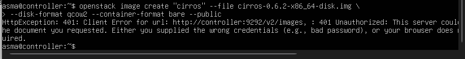

**Diagnostic** : le journal `/var/log/glance/glance-api.log` montrait que Glance n'arrivait pas à joindre Keystone : `Failed to resolve 'conroller'`, un nom d'hôte avec une lettre manquante. Les fichiers de configuration de Glance étaient corrects et `grep` ne trouvait ce nom nulle part dans `/etc`.

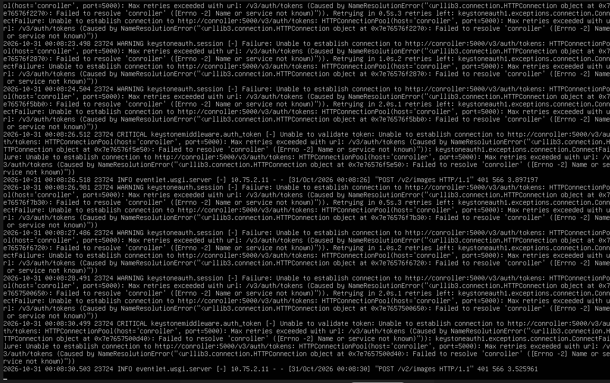

Le résultat de `openstack endpoint list` a révélé l'origine : l'endpoint Keystone de type `internal` avait l'URL `http://conroller:5000/v3/`.

**Cause** : faute de frappe dans `--bootstrap-internal-url` de `keystone-manage bootstrap`. Cette URL est stockée **dans la base de données** (catalogue Keystone), pas dans un fichier, et Glance utilise par défaut l'endpoint `internal`.

**Solution** :
```bash
ID=$(openstack endpoint list --service identity --interface internal -f value -c ID)
openstack endpoint set --url http://controller:5000/v3/ $ID
```
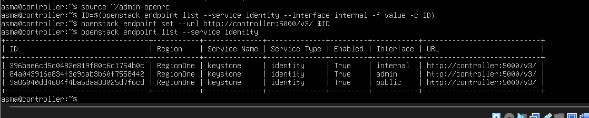

Durant le diagnostic, le problème avait été contourné par un alias du nom fautif dans `/etc/hosts`. Cet alias a ensuite été retiré, et l'import d'image fonctionne sans lui :

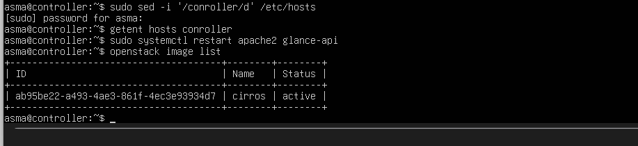

**Enseignement** : un 401 de Glance peut venir de la connexion de Glance vers Keystone. Lire le journal du service, puis vérifier le catalogue (`openstack endpoint list`).

## 2. Memcached bloqué en `activating (start-pre)`

**Symptôme** : `Job for memcached.service failed because a timeout was exceeded`.

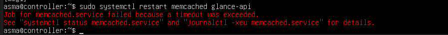

`systemctl status` indiquait `activating (start-pre)` et `Cannot open netlink socket: Address family not supported by protocol`.

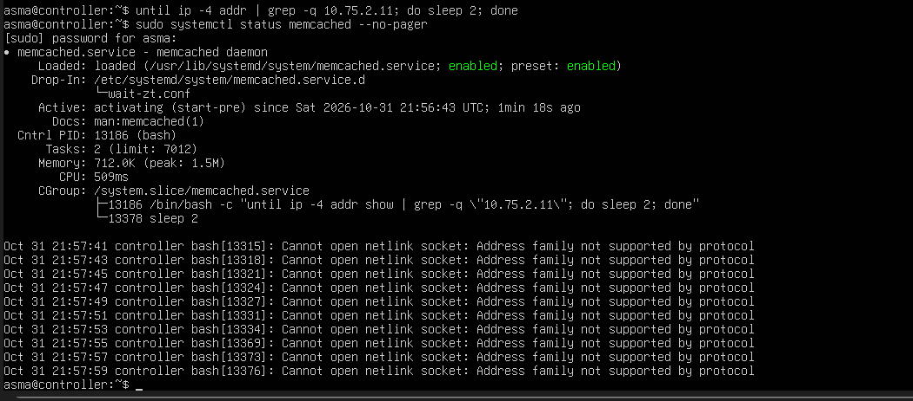

**Cause** : le fichier systemd `wait-zt.conf` attendait l'IP ZeroTier avec `ip -4 addr`. Dans l'environnement restreint (sandbox) du service, `ip` ne peut pas ouvrir de socket netlink : la boucle ne se terminait jamais.

**Solution** : lire l'adresse dans `/proc/net/fib_trie`, qui ne nécessite pas netlink, avec un délai de démarrage plus long.
```ini
[Unit]
After=zerotier-one.service
Wants=zerotier-one.service
[Service]
TimeoutStartSec=180
ExecStartPre=/bin/sh -c 'until grep -q "10.75.2.11" /proc/net/fib_trie; do sleep 2; done'
```
Puis `sudo systemctl daemon-reload && sudo systemctl restart memcached`.

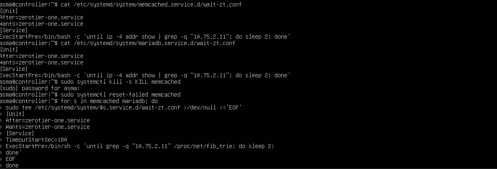
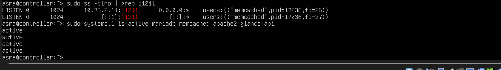

**Enseignement** : une commande qui marche dans un terminal peut échouer dans un service systemd sandboxé.

## 3. Erreurs de saisie et d'environnement 

| Symptôme | Cause | Correction |
|---|---|---|
| `invalid choice: 'qcrow2'` | lettre en trop dans `--disk-format` | `qcow2` |
| option inconnue `--controller-format` | confusion avec `--container-format` | `--container-format bare` |
| `Missing value auth-url required for auth plugin password` | variables `OS_*` absentes du terminal | `source ~/admin-openrc` |

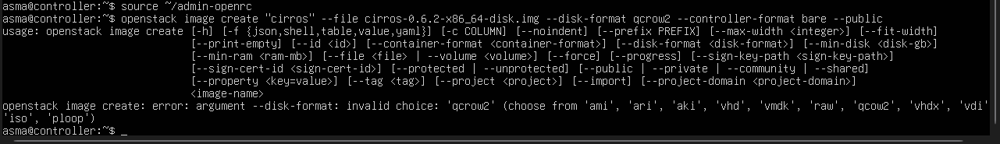

**Enseignement** : pour les commandes longues, préparer la commande dans un éditeur de texte puis la coller permet de la relire avant exécution ; mais l'essentiel est de vérifier les valeurs attendues dans l'aide (--help) et de lire le message d'erreur en entier.

## 4. `keystone-manage db_sync` : `ConfigFileParseError`

**Symptôme** : `Failed to parse /etc/keystone/keystone.conf` avec, plus haut dans la trace, `No ':' or '=' found in assignment`.

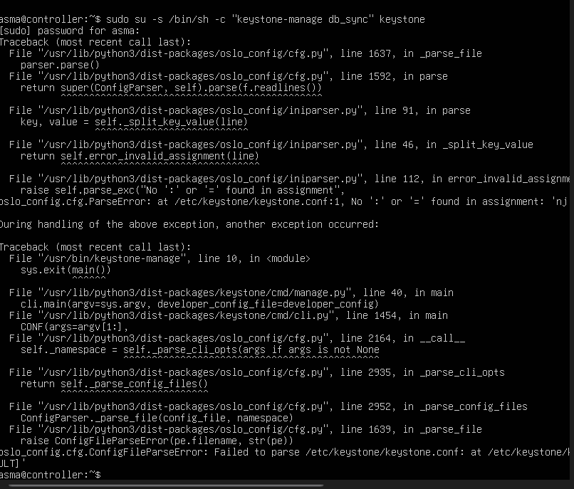

**Cause** : une ligne de `keystone.conf` n'était pas de la forme `clé = valeur` (texte saisi par erreur dans l'éditeur). Le format INI d'oslo.config refuse toute ligne sans `=`.

**Solution** : retrouver la ligne fautive avec `sudo grep -vn '^\s*#' /etc/keystone/keystone.conf | grep -v '='`, la corriger, relancer `db_sync`.

**Enseignement** : la trace Python se lit de bas en haut ; la dernière exception donne le fichier, la première la cause.

## 5. `neutron-db-manage upgrade head` : erreur SQLite

**Symptôme** : `NotImplementedError: No support for ALTER of constraints in SQLite dialect`. Les logs d'Alembic annonçaient `Context impl SQLiteImpl`, alors que MySQL était attendu.

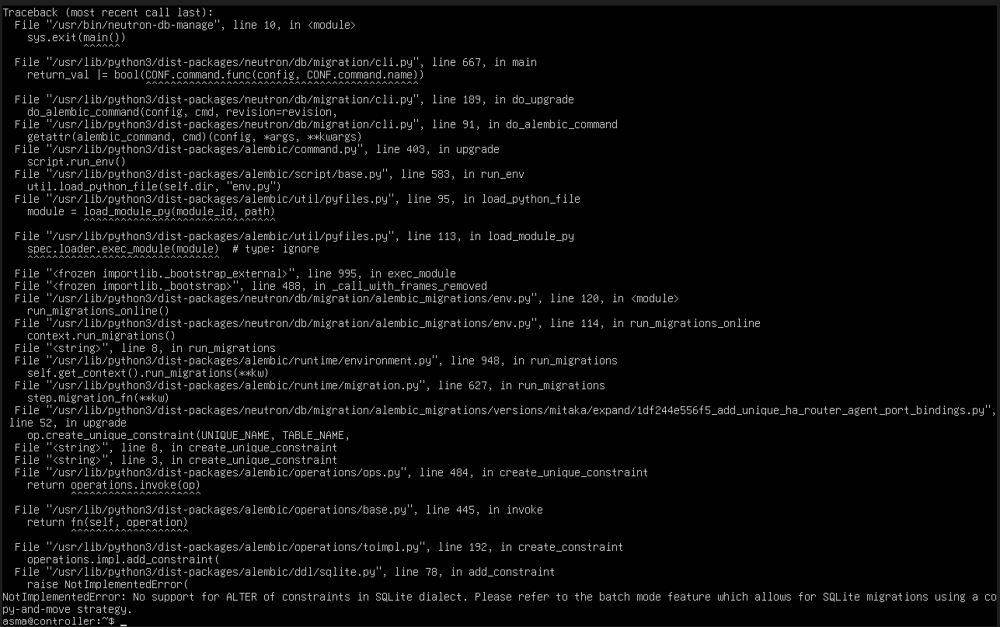

**Cause** : la ligne `connection = mysql+pymysql://...` n'était pas lue dans la section `[database]` de `neutron.conf` ; Neutron utilisait SQLite par défaut.

**Solution** : placer la ligne sous le **vrai** titre `[database]` (repéré avec `sudo grep -n "^\[" /etc/neutron/neutron.conf`), puis relancer la migration. Le journal annonce désormais `Context impl MySQLImpl`.

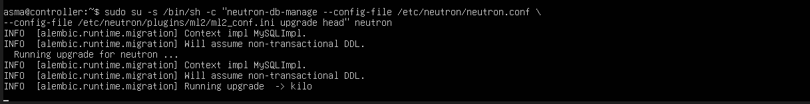

## 6. `placement-status upgrade check` : `RequiredOptError`

**Cause** : `/etc/placement/placement.conf` n'est lisible que par `root` et le groupe `placement` ; lancé sans `sudo`, l'outil ne lisait pas la configuration (`value required for option connection in group [placement_database]`).

**Solution** : `sudo placement-status upgrade check` (résultat `Success`).

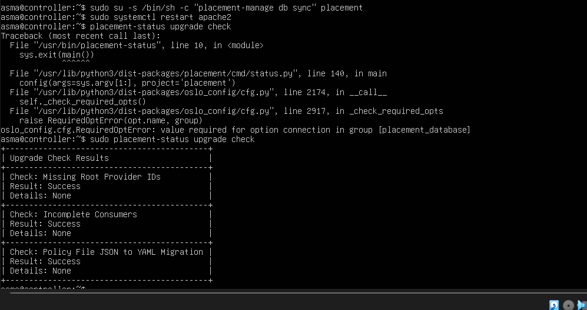

Remarque : la synchronisation s'écrit `placement-manage db sync` (espace), alors que Keystone et Glance utilisent `db_sync`.

## 7. Horizon : `500 Internal Server Error`

**Symptôme** : page `Internal Server Error` sur `http://10.75.2.11/horizon`.

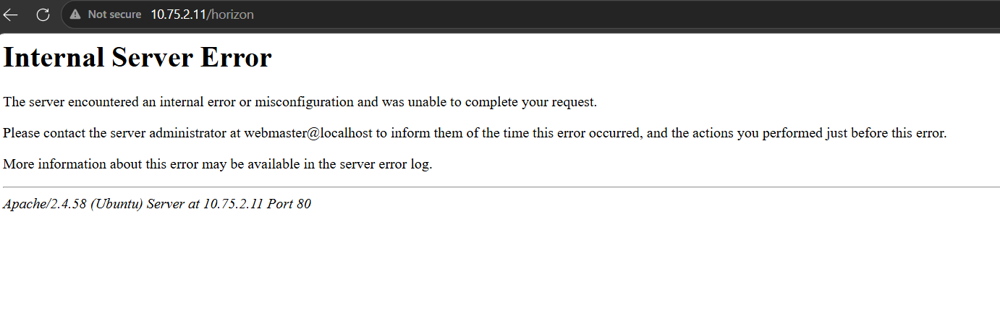

**Diagnostic** : `sudo tail /var/log/apache2/error.log` indiquait `SyntaxError: unterminated string literal` dans `local_settings.py`, à la ligne `'BACKEND': ...`.

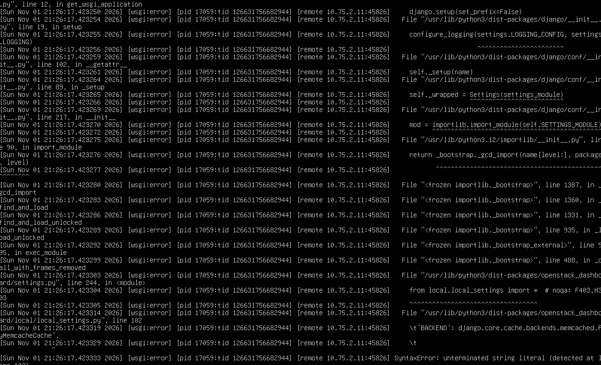

**Cause** : guillemet ouvrant manquant devant `django.core.cache.backends.memcached.PyMemcacheCache`.

**Solution** : corriger la ligne, vérifier avec `sudo python3 -m py_compile /etc/openstack-dashboard/local_settings.py`, puis `sudo systemctl restart apache2`.

## 8. Horizon : « Something went wrong! » après connexion

**Symptôme** : la page de login s'affichait, mais la connexion aboutissait à une page d'erreur générique.

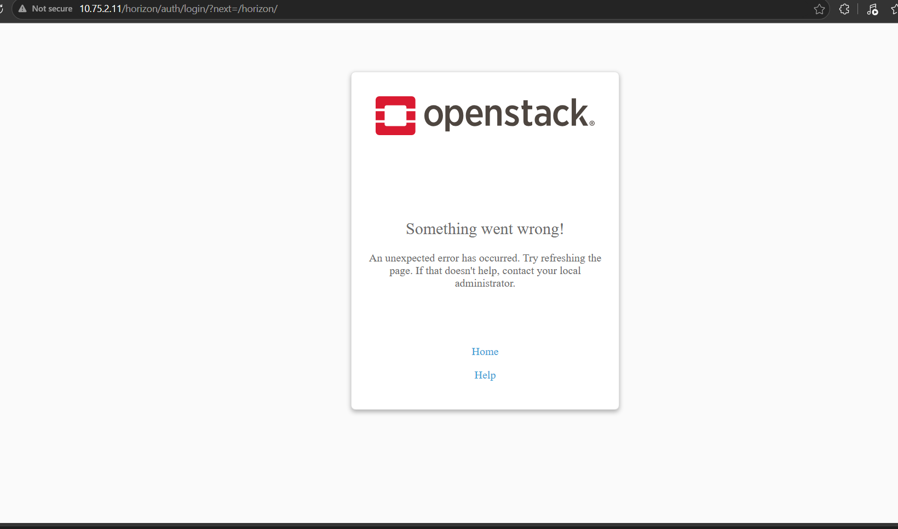

**Diagnostic** : le journal Apache montrait une exception dans `openstack_dashboard/api/neutron.py` et un `Connection to neutron failed: HTTPConnectionPool(host='controller', port=9696)`. `systemctl status neutron-server` indiquait un service en échec, en redémarrage continu.

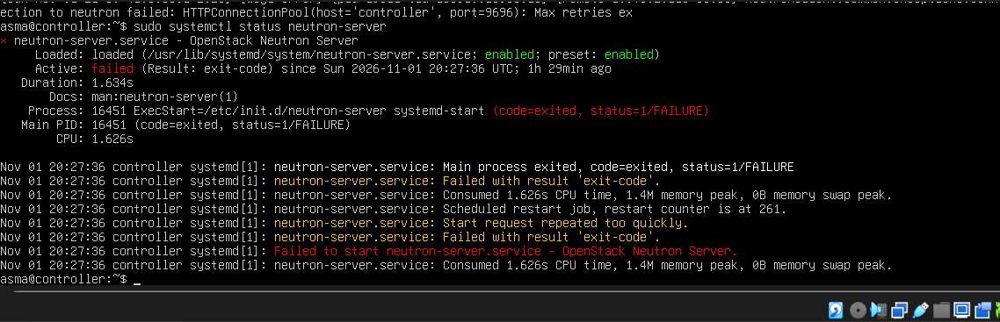

**Cause** : Horizon interroge Neutron (quotas, réseaux) ; `neutron-server` n'était pas en service. Il avait été démarré avant que sa configuration et sa base de données soient correctes (voir incident n°5).

**Solution** : une fois la base migrée, `sudo systemctl restart neutron-server`. Contrôle : le port 9696 est en écoute (`netstat -lnpt | grep 9696`) et Horizon répond `302` vers la page de login.

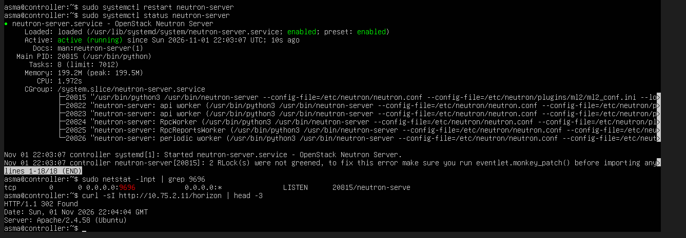

**Enseignement** : une erreur côté interface web peut venir d'un service backend ; suivre la chaîne jusqu'au service qui ne répond pas.

## Conclution
Sur les 8 incidents, 6 relevaient de la configuration ou de l'architecture, 1 de l'environnement systemd et 1 de l'ergonomie de saisie — ce qui illustre la complexité réelle d'un déploiement manuel multi-nœuds.

## Notes

- **Avertissement `RLock(s) were not greened`** : affiché à chaque `nova-manage` avec les paquets Ubuntu 24.04. Sans conséquence, les migrations se terminent correctement.
- **nano** : `Ctrl+W` s'arrête sur les commentaires qui contiennent `[DEFAULT]`. La vraie section se trouve avec `sudo grep -n "^\[" fichier`, puis `Ctrl+_` et le numéro de ligne.
- **Relire le fichier réel, sans commentaires** : `sudo grep -v '^\s*#' fichier | grep -v '^\s*$'`.
- Les IP d'exemple de l'Install Guide sont remplacées par celles du réseau ZeroTier (10.75.2.x).
