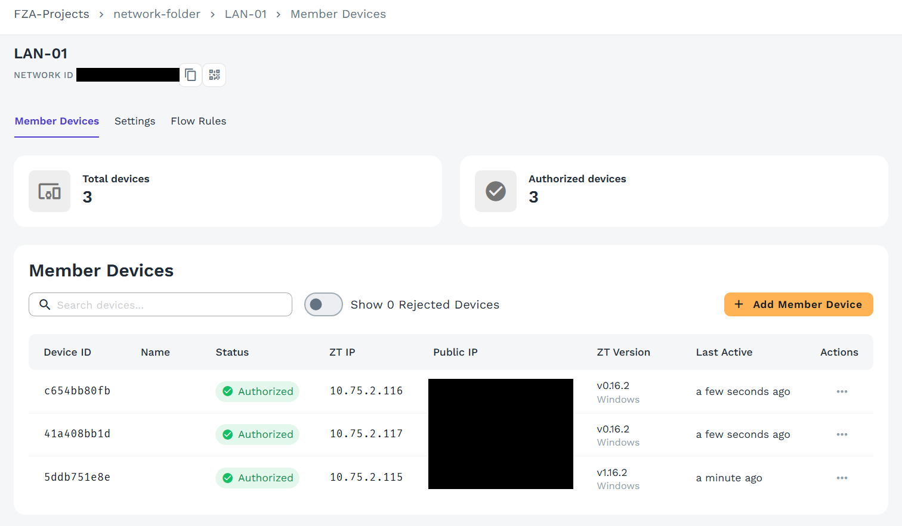
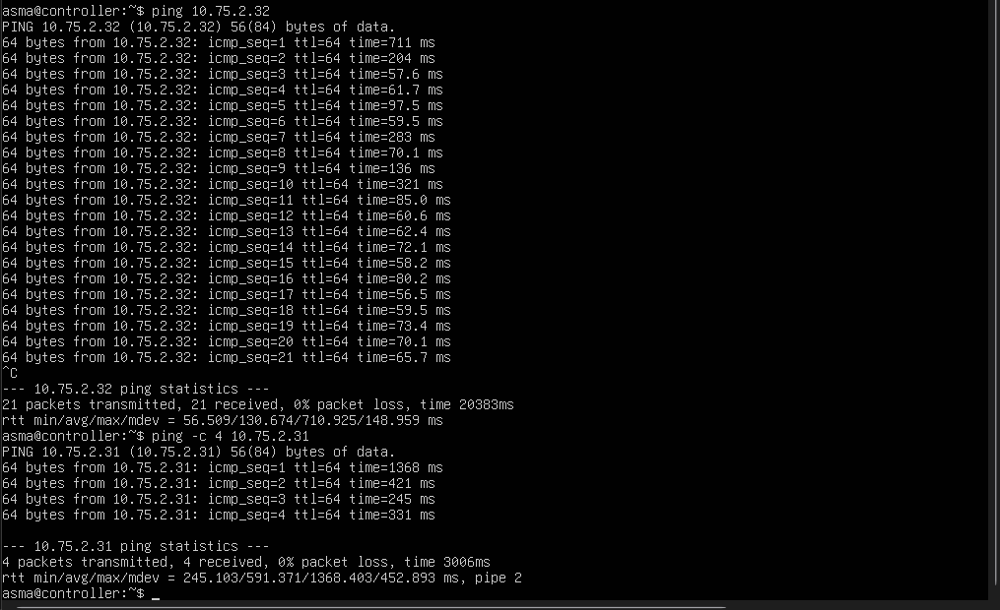

# Choix techniques et justifications

## 1. Installation manuelle plutôt que DevStack

| Solution | Raison du rejet |
|---|---|
| DevStack | Mono-nœud par défaut, redémarre de zéro, masque la configuration derrière un script. |
| Kolla-Ansible | Conteneurs et forte consommation de RAM : trois VM à 4-6 Go ne suffisent pas. |
| MicroStack | Fonctionnement interne caché par l'outil. |
| **Install Guide manuel (retenu)** | Architecture de référence (1 contrôleur + 2 compute), chaque service visible, chaque fichier de configuration compris. |

Bénéfice concret : des pannes qu'un installeur automatique aurait masquées ont pu être diagnostiquées (endpoint Keystone mal orthographié stocké en base, service systemd sandboxé, paramètre lu dans la mauvaise section). Voir [05-problemes-solutions.md](05-problemes-solutions.md).

## 2. ZeroTier comme réseau de management

Les trois machines sont chez trois personnes différentes, sans réseau local commun.

- **IP fixes** assignées par membre (10.75.2.11, .31, .32) : indispensable, car les endpoints Keystone, les URL RabbitMQ et les `local_ip` VXLAN sont écrits en dur.
- **Trafic chiffré** de bout en bout : les mots de passe et jetons ne circulent jamais en clair sur Internet.
- **Aucune ouverture de port** sur les box ni exposition publique.
- **Un seul réseau** sert à la fois au management et aux tunnels VXLAN des VM.

Limite mesurée : la latence entre nœuds varie de 55 ms à plus de 1 s selon les moments (chemin relayé). Acceptable pour un laboratoire, à éviter en production. Mesure : 

## 3. Services à l'écoute uniquement sur ZeroTier

MariaDB (`bind-address = 10.75.2.11`) et Memcached n'écoutent que sur l'IP ZeroTier. Conséquence : ils doivent attendre que l'interface ZeroTier existe au démarrage, ce résolu par un fichier systemd dédié (incident n°2).

## 4. VXLAN et pas de réseau « provider »

Sans seconde carte réseau physique, pas de réseau externe flat/VLAN. Les réseaux de projet sont en VXLAN (`tenant_network_types = vxlan`, VNI 1:1000), avec `l2_population` activé. Le trafic des VM est encapsulé dans le tunnel ZeroTier. Un routeur virtuel relie deux réseaux privés.

## 5. Hygiène de sécurité du dépôt

- Mot de passe remplacé par `<PASSWORD>` par script, jamais à la main.
- `.gitignore` bloquant `*-openrc`, clés, images disque, journaux.
- Script de contrôle avant commit.
- Captures contrôlées et masquées (ID du réseau ZeroTier, IP publiques, mots de passe d'instances).
